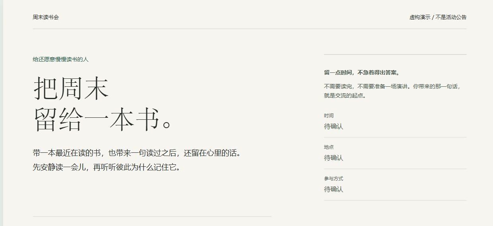
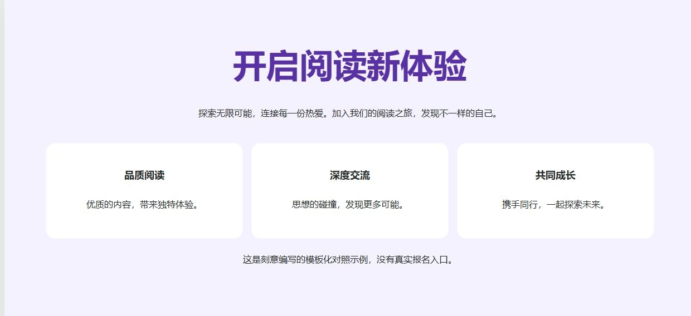
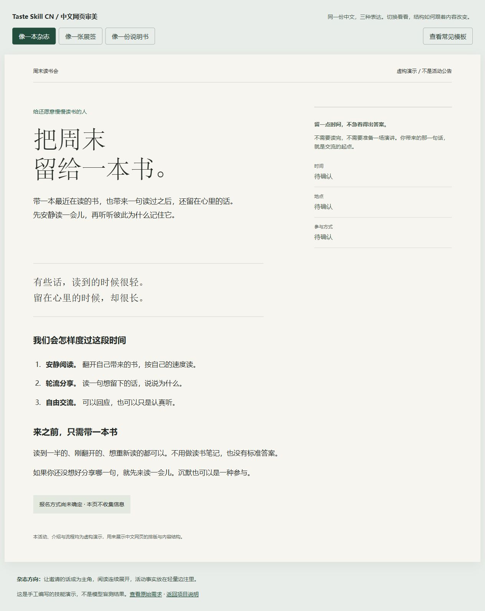
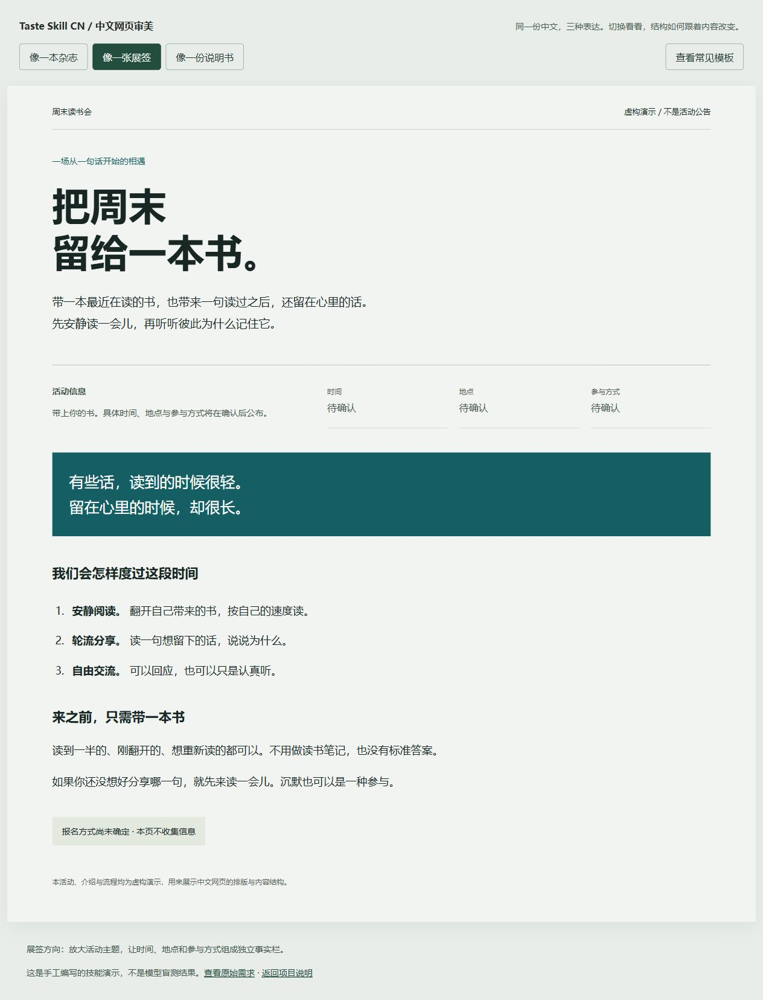
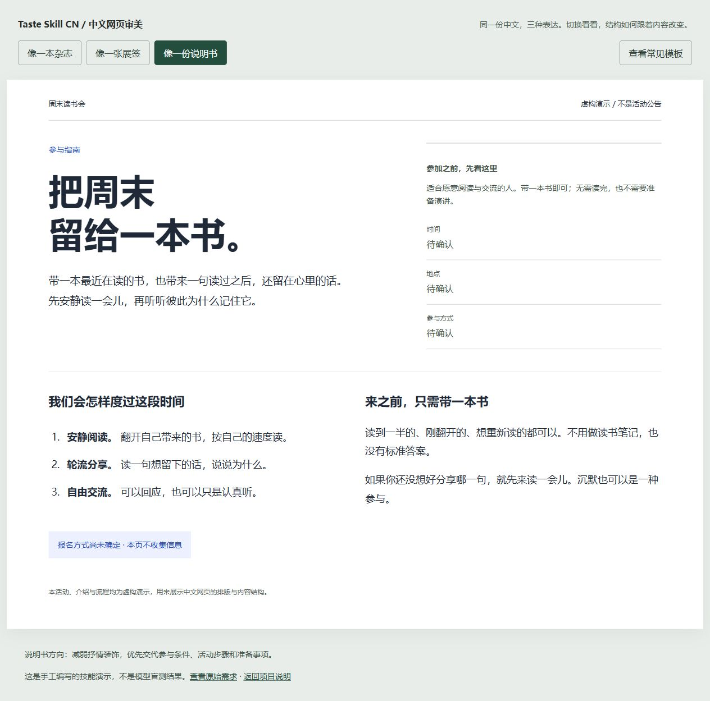

<div align="center">

# Taste Skill CN

### 让 AI 写中文网页，也懂中文的美。

**把文章、活动介绍和产品说明，做成有自己气质的网页。**

不懂设计术语也能用。告诉 AI：像一本杂志、像一张展签，或像一份清楚的说明书。

[](LICENSE)
[](skills/taste-skill-cn/SKILL.md)
[](#我们做了哪些不同)

[看前后对比](#同一份需求换一种表达) · [选你的风格](#不只换颜色而是换一种表达方式) · [立即安装](#一行安装) · [来源与致谢](#来源与致谢)

</div>



<p align="center"><sub>仓库示例的真实浏览器截图 · 中文内容先行 · 无外部字体或图片依赖</sub></p>

## 同一份需求，换一种表达

> 做一个中文读书会网页，叫“把周末留给一本书”。先安静阅读，再轮流分享。时间、地点和报名方式还没有确定。

<table>
  <tr><th width="50%">Before · 模板化表达</th><th width="50%">After · 从中文内容出发</th></tr>
  <tr>
    <td valign="top"><a href="docs/images/before.jpg"></a></td>
    <td valign="top"><a href="docs/images/magazine.jpg"></a></td>
  </tr>
  <tr>
    <td valign="top">泛化标题：“开启阅读新体验”<br>三个相近卖点：“品质阅读／深度交流／共同成长”<br>读完依然不知道具体怎样参与</td>
    <td valign="top">保留原话：“把周末留给一本书”<br>导语写清带什么、做什么<br>未知信息明确标为“待确认”</td>
  </tr>
</table>

**改变的不只是配色。是标题说什么、信息放哪里，以及中文怎样被阅读。**

<sub>以上均为本仓库手工编写示例的实际截图。Before 是刻意编写的模板化对照，After 是中文内容设计示例；不是同模型安装前后的盲测，也不是与 Taste Skill 原项目的效果比较。点击图片可看完整截图。[原始需求](examples/brief.md) · [截图记录](docs/SCREENSHOTS.md)</sub>

## 一行安装

```bash
npx skills add batespaige357-tech/taste-skill-cn --skill taste-skill-cn
```

然后对你的 AI 说：

```text
用 taste-skill-cn 把我的中文内容做成网页。
像一本杂志，保留原文的表达，手机上读起来舒服。
```

支持读取 Agent Skills 的编程助手。技能本身不需要额外 API Key、不运行安装脚本；模型服务沿用你的账号配置。

<details>
<summary>手动安装与调用方式</summary>

下载仓库，将 **`skills/taste-skill-cn` 整个文件夹**复制到助手的技能目录，例如：

- Codex：`~/.codex/skills/taste-skill-cn/`
- Claude Code：`~/.claude/skills/taste-skill-cn/`

重新打开会话。Codex 中可使用 `$taste-skill-cn`；其他工具的目录与调用方式以其说明为准。

</details>

## 不只换颜色，而是换一种表达方式

同一份读书会材料，三个方向。点击截图查看大图。

<table>
  <tr><th width="33%">像一本杂志</th><th width="33%">像一张展签</th><th width="33%">像一份说明书</th></tr>
  <tr>
    <td valign="top"><a href="docs/images/magazine.jpg"></a></td>
    <td valign="top"><a href="docs/images/exhibit.jpg"></a></td>
    <td valign="top"><a href="docs/images/manual.jpg"></a></td>
  </tr>
  <tr>
    <td valign="top"><strong>让观点与阅读节奏做主角。</strong><br>适合文章、专栏、访谈、作品集。</td>
    <td valign="top"><strong>让主题与关键信息站出来。</strong><br>适合展览、活动、文化空间。</td>
    <td valign="top"><strong>先看懂，再决定下一步。</strong><br>适合工具、产品、服务与指南。</td>
  </tr>
</table>

想自己切换？下载后打开 **[preview/index.html](preview/index.html)**，无需安装、联网或编译。GitHub 文件页显示的是源码，需下载后在浏览器打开。

## 我们做了哪些不同

**中文不是英文模板的替换文本。**

| 你可能遇到的问题 | Taste Skill CN 的处理方式 |
|---|---|
| 中文标题一放进去，换行就碎了 | 先看真实字数、语义停顿和手机宽度，再决定排版 |
| 每段内容都被装进同一种卡片 | 按读者的问题组织页面，长文章保留连续阅读 |
| 一说“高级”，就变成米白底、宋体、红印章 | 从内容与品牌选方向，中文也可以清楚、冷静、大胆 |
| 不懂网格、字体配对等设计词 | 用“杂志／展签／说明书”等日常语言表达偏好 |
| 日期、地址、评价被 AI 补出来了 | 保留事实来源，缺的信息标记待确认 |

可用于新建网页、局部改版，也可以只做中文页面审美评审。沿用项目已有框架与品牌，不扩大修改范围。

## 直接试这三个需求

**文章转网页**

> 用 taste-skill-cn 把这篇文章做成网页，像一本安静的杂志。保留论证和引用，不要压缩成三张卖点卡。

**活动介绍**

> 用 taste-skill-cn 做读书会介绍页，像一张展签。时间地点还没确定，请明确标出来。

**中文产品页改版**

> 用 taste-skill-cn 改这个中文产品页，像一份清楚的说明书。让人先看懂它能做什么，再看到行动入口。

## 来源与致谢

受 **[Leonxlnx/taste-skill](https://github.com/Leonxlnx/taste-skill)** 启发，独立维护、非官方。感谢原项目把网页设计判断转化为可执行规则的思路。

本版技能正文、中文排版参考、内容叙事方法、CSS 和演示重新编写；没有打包上游代码、摄影或视觉标识，也不依赖安装原技能。

我们的方向是**中文内容与阅读体验**：不强制整屏区块，不要求每页动效，按内容长度安排结构。`cn` 表示中文设计方向，不表示官方翻译。

[来源与参考提交](ATTRIBUTION.md) · [上游 MIT 许可](licenses/taste-skill-MIT.txt) · [本项目 MIT 许可](LICENSE)

<details>
<summary>项目结构与验证范围</summary>

```text
skills/taste-skill-cn/
  SKILL.md                    技能入口
  agents/openai.yaml          Codex 展示信息
  references/                 中文排版、叙事、风格与检查表
  assets/typography.css       可选、局部生效的排版底座
preview/index.html            无依赖交互示例
docs/images/                  真实浏览器截图
examples/brief.md             演示原始需求
```

当前技能版本 **v0.1.0**。技能格式、UTF-8、本地链接、脚本语法与交互逻辑已检查；本次也在浏览器查看了桌面示例及风格切换。

尚未完成真实助手的端到端安装、生成质量测评、手机与读屏验收。截图展示示例页面，不保证每次模型生成的效果。未运行前端编译。[验证记录](VALIDATION.md)

</details>

---

<div align="center">

**如果你也想让 AI 写出更懂中文的网页，点个 Star，关注后续更新。**

也欢迎带一个具体页面来：[提交排版问题](https://github.com/batespaige357-tech/taste-skill-cn/issues) · [查看版本](https://github.com/batespaige357-tech/taste-skill-cn/releases)

<sub>提交截图前，请移除个人信息与密钥。</sub>

</div>
